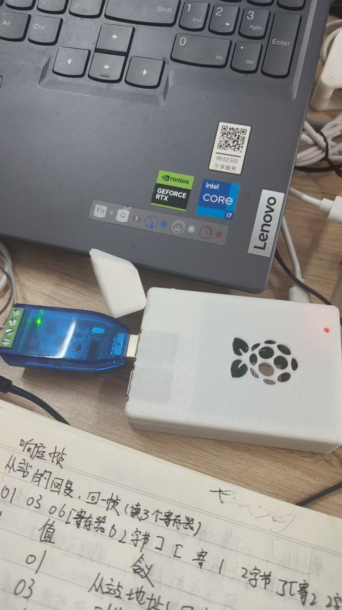

# 基于 STM32F407 的工业数据采集终端

> 一款端到端的工业物联网数据采集系统：STM32 采集三路模拟量 → Modbus-RTU 从站 → RS485 差分总线 → 树莓派网关 → 网页实时监控大屏（支持外网访问）。

## 项目简介

以 STM32F407ZGT6（正点原子探索者）为核心，采集**电压 / 温度 / 光强**三路模拟量，经两级数字滤波后写入 Modbus 保持寄存器；通过 RS485 总线传给树莓派网关（Modbus 主站），再由 Flask + SocketIO 实时推送到浏览器监控大屏，实现「工业现场数据 → 云端可视化」的完整闭环。

## 演示



*上图是实际接线现场：STM32 从站经 RS485 接到树莓派 3B+ 的 USB 转 485 模块；纸上是 Modbus 帧格式的手写推演（`01 03 06 ...`）。*

**▶ [观看完整演示视频](docs/demo/demo.mp4)**

| 想先看什么 | 去哪看 |
|---|---|
| 怎么跑起来的、踩了哪些坑 | [docs/踩坑记录.md](docs/踩坑记录.md)（27 条，含现象/根因/解决） |
| 实测数据与 Modbus 帧解析 | [docs/测试记录.md](docs/测试记录.md) |
| 10 天 16 个阶段的开发过程 | [docs/开发日志.md](docs/开发日志.md) |

## 系统架构

```
┌──────────────────────────── STM32F407（从站）────────────────────────────┐
│  ADC1（DMA 双通道）  电压 / 温度                                        │
│  ADC3（单通道轮询）   光强                                              │
│        ↓ 两级滤波（中值去尖峰 + 滑动平均平滑）                            │
│  FreeRTOS 多任务（采集 / 显示 / Modbus / 看门狗 / 日志）                  │
│        ↓ 写 mb_holding_regs[]                                          │
│  Modbus-RTU 从站（USART2，9600）                                        │
└──────────────────────────────────┬──────────────────────────────────────┘
                                   │ RS485（A/B 差分，SP3485）
                                   ▼
┌──────────────────────── 树莓派 3B+（主站 + 网关）────────────────────────┐
│  minimalmodbus 每秒轮询：01 03 00 00 00 03                              │
│  Flask + Flask-SocketIO（后台线程读数据 + 主动推送）                      │
└──────────────────────────────────┬──────────────────────────────────────┘
                                   │ SocketIO 实时推送
                                   ▼
                       ┌────────────────────────────┐
                       │        浏览器监控大屏        │
                       │  实时卡片 + 历史曲线 + 报警   │
                       │   （cpolar 内网穿透，外网访问）│
                       └────────────────────────────┘
```

## 功能特性

### 采集端（STM32 固件）
- **三路模拟量采集**：电压（电位器分压）、温度（芯片内部温度传感器）、光强（光敏电阻）
- **两级数字滤波**：中值滤波（窗口 5 去尖峰）+ 滑动平均（窗口 8 平滑）
- **FreeRTOS 多任务**：采集 / 显示 / Modbus / 看门狗 / 日志 任务并行，互斥锁保护共享数据
- **Modbus-RTU 从站**：功能码 03 读保持寄存器，寄存器 0/1/2 分别存电压×100、温度×10、光强 0~100
- **RS485 差分总线**：板载 SP3485，抗干扰，适配工业现场
- **独立看门狗 IWDG**：约 2.5s 超时，程序跑飞自动复位
- **日志库**：分级（DEBUG/INFO/WARN/ERROR）+ 阈值过滤 + SD 卡落盘（FATFS）+ 文件轮转
- **EEPROM 掉电保存**：AT24C02（I2C），断电不丢配置
- **TFT LCD 显示**：4.3 寸屏实时显示三路数据

### 网关端（树莓派）
- **Modbus 主站**：Python minimalmodbus 每秒轮询三路寄存器
- **实时推送**：Flask-SocketIO，WebSocket 主动推送（区别于前端轮询）
- **监控大屏**：三张实时卡片 + Chart.js 历史曲线 + 阈值报警（欠压 / 高温 / 过暗）
- **内网穿透**：cpolar，外网可访问

## 硬件组成

| 模块 | 型号 / 接口 | 引脚 | 说明 |
|---|---|---|---|
| 主控 | STM32F407ZGT6 | — | 正点原子探索者开发板 |
| 电压采集 | 电位器 RV1 | PA5（ADC1_IN5） | 0~3.3V 分压 |
| 温度采集 | 芯片内部温度传感器 | ADC1 | 内部通道 |
| 光强采集 | GL5506 光敏模块 | PF7（ADC3_IN5） | 分压电路 |
| RS485 | 板载 SP3485 | USART2（PA2/PA3）+ PG8 | 差分总线 |
| 显示屏 | 4.3 寸 TFT LCD | FSMC Bank4 | 8080 并口 |
| 存储 | MicroSD 卡 | SDIO | 日志落盘 |
| EEPROM | AT24C02 | I2C1 | 掉电保存 |
| 网关 | 树莓派 3B+ | USB 转 RS485 | Modbus 主站 |

## 目录结构

```
.
├── firmware/                    # STM32 固件（Keil MDK-ARM 工程）
│   ├── Core/                    # 用户代码（Src/Inc + BSP 驱动）
│   │   └── BSP/                 # LCD / LOG / SDIO / EEPROM
│   ├── Drivers/                 # STM32F4 HAL 库 + CMSIS
│   ├── Middlewares/             # FreeRTOS + FATFS
│   ├── MDK-ARM/                 # Keil 工程文件（.uvprojx）
│   └── Modbus_Slave.ioc         # CubeMX 配置
├── gateway/                     # 树莓派网关（Python）
│   ├── app.py                   # Flask + SocketIO 服务
│   ├── requirements.txt         # 依赖清单
│   └── templates/index.html     # 监控大屏前端
└── docs/                        # 过程文档（调试记录都在这里）
    ├── 踩坑记录.md               # 27 条：现象 / 根因 / 解决
    ├── 测试记录.md               # 实测帧、验收数据、待补项
    ├── 开发日志.md               # 10 天 16 阶段时间线
    ├── images/                  # 实物与截图
    └── demo/demo.mp4            # 演示视频
```

## 快速开始

### 1. STM32 固件
1. 用 Keil MDK-ARM 打开 `firmware/MDK-ARM/Modbus_Slave.uvprojx`
2. 编译（F7）→ 烧录（F8）到探索者板
3. 接线：电位器接 PA5，光敏模块接 PF7，RS485 的 A/B 接 USB 转 RS485 模块

### 2. 树莓派网关
```bash
cd gateway
pip install -r requirements.txt --break-system-packages
python3 app.py
# 浏览器打开 http://<树莓派IP>:5000
```

### 3. 内网穿透（可选）
用 cpolar 将本地 5000 端口映射到公网，即可外网访问。

## 技术栈

`C` `STM32F407` `FreeRTOS` `CMSIS-RTOS2` `ADC + DMA` `Modbus-RTU` `RS485` `IWDG` `FATFS` `I2C` `FSMC` `Python` `Flask` `Flask-SocketIO` `minimalmodbus` `Chart.js` `cpolar`

## 项目亮点

- **分层解耦**：采集核心逻辑（ADC → 滤波 → 寄存器）从头到尾不变，只换传输方式（串口 / Modbus / RS485）和展示方式（串口 / LCD / 网页），即可完成形态升级
- **工业级稳定性**：看门狗 + 日志 + 滤波 + EEPROM，向企业级项目靠拢
- **端到端闭环**：从传感器到云端可视化完整打通
- **多任务并发**：FreeRTOS 任务划分 + 互斥锁保护共享资源

## 开发过程

10 天、16 个阶段，每阶段留独立快照与调试存档（`裸机备份_20260914`、`阶段3快照-已验证` 等）：

| 日期 | 阶段 | 结果 |
|---|---|---|
| 09-10 | ADC+DMA 采集 → Modbus-RTU 从站 → 两者合体 | 三路采集写入保持寄存器 ✅ |
| 09-11 | 增加第三路光敏（ADC3 轮询） | 三路同时上报 ✅ |
| 09-13 | 物理层升级 RS485（DE/RE 方向控制） | 实测帧 CRC 吻合 ✅ |
| 09-13 | 树莓派 minimalmodbus 读数据 | 终端稳定读数 ✅ |
| 09-14 | 两级滤波（中值 5 + 滑动平均 8）+ IWDG 看门狗 | 数据平滑、系统不误复位 ✅ |
| 09-14 | Flask 网页 → systemd 常驻 → cpolar 内网穿透 | 外网可访问 ✅ |
| 09-15 | 裸机 `while(1)` 重构为 FreeRTOS 5 任务 | 采集/显示/Modbus/喂狗并行 ✅ |
| 09-19 | 日志库 + SD 卡落盘 + EEPROM 掉电保存 | 稳定性三件套完成 ✅ |

完整过程（含每阶段卡点数量与转折点复盘）：[docs/开发日志.md](docs/开发日志.md)

## 关键排障（节选）

这个项目 10 天里卡过 27 次，全部记录在 [docs/踩坑记录.md](docs/踩坑记录.md)。几个典型的：

| 现象 | 根因 |
|---|---|
| ADC 读数恒为 4095 | 开源工程把通道配在 PA3，而 PA3 在这块板上是 USART2_RX（蓝牙串口），引脚悬空 → 满量程 |
| 读数死卡在 3110（≈2.5V），拧电位器不动 | P11 跳线帽插在 `ADC↔TPAD`，PA5 接的是触摸按键的固定偏置，不是电位器抽头 |
| RS485 主站发帧，从站完全不响应 | A/B 接反，差分逻辑整体取反，CRC 必然失败后静默丢弃 |
| CubeMX 配 115200，实际必须用 9600 | `Modbus_Init()` 按 Flash 里存的配置重配 UART，把 CubeMX 的设置覆盖了 |
| 加日志落盘后 Modbus 偶发超时 | SD 卡是块设备（读 512B → 改 → 写回），同步写把业务任务卡住 → 改队列异步 + 队列满丢弃 |

## 文档

| 文件 | 内容 |
|---|---|
| [docs/开发日志.md](docs/开发日志.md) | 10 天 16 阶段时间线、三个技术转折点、工程习惯复盘 |
| [docs/踩坑记录.md](docs/踩坑记录.md) | 27 条排障记录，分板级硬件 / 协议 / RTOS / 文件系统 / Linux 部署五类 |
| [docs/测试记录.md](docs/测试记录.md) | 阶段验收表、Modbus 实测帧逐字段解析、关键参数实测值、待补验证 |
| [docs/images/README.md](docs/images/README.md) | 图片素材清单与拍摄建议 |

## License

[MIT](LICENSE)
